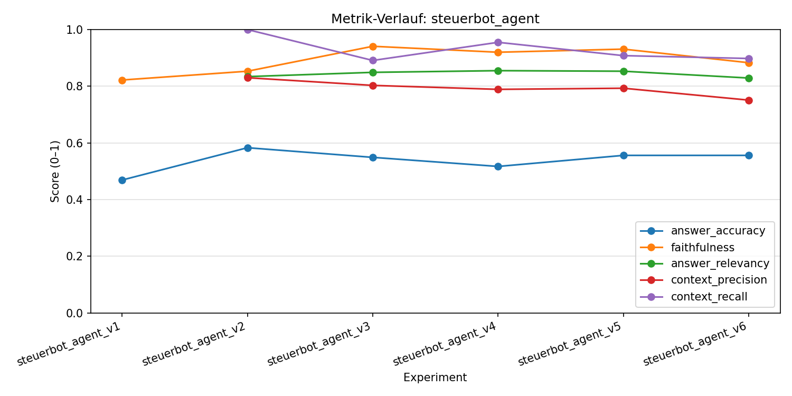

# Steuer-Chatbot Zürich

Retrieval-Augmented Generation (RAG) Chatbot für Züricher Steuerrecht, entwickelt im Rahmen des Moduls *Hands-on Chatbot* an der OST (FS26).

Der Chatbot beantwortet Steuerfragen auf Basis lokaler Rechtsdokumente (PDFs, HTML, Markdown) sowie dem Online-Steuerbuch des Kantons Zürich (zh.ch) — ohne aus dem Modell-Gedächtnis zu antworten.

---

## Architektur

```
Nutzerfrage
    │
    ├─► TopicGuardrail (klassifiziert ob Steuerfrage)
    │
    ├─► Multi-Query Rewriting  (gpt-4o-mini, 3 alternative Queries)
    │       │
    │       └─► ChromaDB Similarity Search (4 Queries × 5 Chunks)
    │               │
    │               └─► Cross-Encoder Reranking → Top 6 Chunks
    │
    ├─► Agent (gpt-4o)
    │       │
    │       └─► Tool: search_steuerbuch (zh.ch API, bei Bedarf)
    │
    └─► Antwort mit Quellenangaben (Streamlit, Token-by-Token)
```

### Retrieval-Pipeline

Die lokale Suche nutzt eine zweistufige Pipeline:

1. **Multi-Query Rewriting**: `gpt-4o-mini` generiert 3 alternative Suchanfragen in Steuer-Fachsprache (z.B. aus *"zuhause arbeiten"* wird *"Homeoffice-Abzug"*, *"Arbeitszimmer steuerlich"*, *"Teleworking Kosten"*). Damit werden 4 Queries total gegen ChromaDB ausgeführt.

2. **Cross-Encoder Reranking**: Die bis zu 20 resultierenden Chunks werden vom Modell `cross-encoder/msmarco-MiniLM-L12-en-de-v1` als (Query, Chunk)-Paare bewertet. Nur die 6 relevantesten Chunks werden an den Agent weitergegeben.

### Agent

Der Agent (LangChain, GPT-4o) entscheidet kontextabhängig ob das Online-Steuerbuch (`search_steuerbuch`) zusätzlich konsultiert werden soll — insbesondere bei kantonalen Zürich-spezifischen Regelungen, Steuertarifen und gesetzlichen Fristen. Die Chat-History wird auf die letzten 6 Frage-Antwort-Paare begrenzt (Rolling Window).

---

## Datenquellen

### Lokal (ChromaDB)

| Typ | Inhalt |
|-----|--------|
| PDFs | Steuergesetz ZH 631.1, Wegleitung ZH 2025, Merkblatt Selbstständige ZH 2025 |
| PDFs | ~75 ESTV-Kreisschreiben (KS Nr. 3–50a) |
| PDFs | 14 Tabellen-PDFs: Steuersätze, Abzüge, Kantonsvergleiche 2025 |
| PDFs | Buch: *Der Steuerberater – Steuern optimieren* |
| HTML | SR 642.11 DBG, SR 642.14 StHG, SR 642.21 VStG |
| Markdown | Steueroptimierungs-Guides (Eigenheim, Pensionierung, Selbstständige u.a.) |

### Online

| Quelle | Zugriff |
|--------|---------|
| Zürcher Steuerbuch (zh.ch) | Interner JCR-API-Endpoint, HTML-Scraping |

---

## Chunking-Strategie

Dokumente werden in zwei Passes aufgeteilt:

1. **MarkdownHeaderTextSplitter**: Teilt nach `#`, `##`, `###` Überschriften auf. Jeder Chunk erhält die zugehörige Überschrift als Metadatum (`h1`, `h2`, `h3`).

2. **RecursiveCharacterTextSplitter**: Teilt zu grosse Abschnitte weiter auf (max. 750 Zeichen, 250 Zeichen Overlap). Trennzeichen-Priorität: `\n\n` → `\n` → `.` → ` `.

**Sonderfall Tabellen**: PDFs im Unterordner `Tabellen/` werden nicht durch den Char-Splitter aufgeteilt — die Tabellenstruktur (Spaltenüberschriften + Zeilen) muss als Ganzes erhalten bleiben.

**Filter**: Chunks mit weniger als 30 Zeichen (Seitenzahlen, isolierte Überschriften) werden verworfen.

---

## Evaluation

Die Evaluation verwendet das [RAGAS](https://docs.ragas.io/)-Framework mit 5 Metriken:

| Metrik | Bedeutung |
|--------|-----------|
| `answer_accuracy` | Übereinstimmung mit der Referenzantwort |
| `faithfulness` | Antwortet der Agent nur aus den Quellen (keine Halluzinationen)? |
| `answer_relevancy` | Beantwortet die Antwort die gestellte Frage? |
| `context_precision` | Sind die retrieved Chunks wirklich relevant? |
| `context_recall` | Werden alle relevanten Infos gefunden? |

Das Testset (`evals/datasets/data_v4.csv`) enthält 50 Fragen aus 12 Themenkategorien (Steuerpflicht, Einkommen, Abzüge, Tabellen, ESTV-Kreisschreiben, Buch u.a.).

Jedes Evaluations-Experiment wird versioniert gespeichert (`evals/experiments/steuerbot_agent_vN.csv`). Den Metrik-Verlauf über alle Versionen anzeigen und als PNG speichern:

```bash
uv run python evals/ragas_eval.py
```



---

## Setup

### Voraussetzungen

- Python 3.14+
- [uv](https://docs.astral.sh/uv/)
- OpenAI API Key
- Langfuse API Key (optional, für Observability)

### Installation

```bash
# Dependencies installieren
uv sync

# Umgebungsvariablen konfigurieren
cp .env.example .env
# .env ausfüllen: OPENAI_API_KEY, LANGFUSE_PUBLIC_KEY, LANGFUSE_SECRET_KEY
```

### Starten

```bash
uv run streamlit run main.py
```

Beim ersten Start wird die ChromaDB automatisch befüllt (Embeddings werden einmalig generiert, ca. 5–10 Minuten). Bei nachfolgenden Starts wird die bestehende DB verwendet.

**ChromaDB neu aufbauen** (nach neuen Dokumenten oder Änderungen am Chunking):

```bash
rm -rf chroma_langchain_db/
uv run streamlit run main.py
```

### Login

Zugangsdaten werden über Streamlit Secrets konfiguriert (`.streamlit/secrets.toml`):

```toml
[credentials]
username = "..."
password = "..."
```

---

## Projektstruktur

```
ny-hoc/
├── main.py                  # Streamlit UI, Embedding-Pipeline, Agent
├── tools.py                 # search_steuerbuch (zh.ch), Multi-Query, Reranker
├── custom_agents.py         # TopicGuardrail Middleware
├── observability.py         # Langfuse Callback Handler
├── evals/
│   ├── ragas_eval.py        # Evaluation & Experiment-Visualisierung
│   ├── datasets/            # Testsets (data_v4.csv)
│   ├── experiments/         # Versionierte Experiment-Ergebnisse
│   └── inspect_chunks.py    # Chunk-Inspektion und Qualitätsprüfung
├── ressources/
│   ├── pdf/                 # Steuergesetz, Kreisschreiben, Tabellen, Buch
│   ├── html/                # DBG, StHG, VStG
│   └── md/                  # Markdown-Dokumente
└── PDF_downloader/          # Skript zum Herunterladen der ESTV-Kreisschreiben
```

---

## Technologie-Stack

| Komponente | Technologie |
|------------|-------------|
| LLM | GPT-4o (Agent + Antwort), GPT-4o-mini (Query-Rewriting, Guardrail) |
| Embeddings | OpenAI `text-embedding-3-large` |
| Vektordatenbank | ChromaDB (cosine similarity) |
| Reranker | `cross-encoder/msmarco-MiniLM-L12-en-de-v1` |
| Framework | LangChain 1.2 |
| UI | Streamlit |
| Evaluation | RAGAS |
| Observability | Langfuse |
| Paketmanager | uv |
