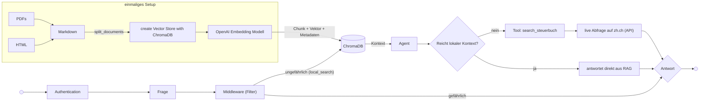

OST FS26 <br>
Yannick Ott und Noah Debbabi <br>
FS26 | 25. Mai 2026

Dozent: Marcel Amsler

# Steuer-Chatbot für den Kanton Zürich

Agentic-RAG-Chatbot für das Zürcher Steuerrecht wurde im Rahmen des Moduls Hands-on Chatbot an der OST entwickelt.

Der Chatbot beantwortet Fragen zum Steuerrecht 2025 und hilft bei der Opimierung der Steuern auf Basis lokaler Rechtsdokumente, Steuertipps, einem Ratgeberbuch (PDFs, HTML, 
Markdown) sowie dem Online-Steuerbuch des Kantons Zürich (zh.ch). 

---

### Quick Setup

**Voraussetzungen**
- Python 3.14+
- [uv](https://docs.astral.sh/uv/)
- OpenAI API Key
- Langfuse API Key (optional, für Observability)

#### Installation

```bash
# Dependencies installieren
uv sync

# .env ausfüllen: 
OPENAI_API_KEY="..."
LANGFUSE_SECRET_KEY="..."
LANGFUSE_PUBLIC_KEY="..."
LANGFUSE_BASE_URL="..."
```

#### Starten
Beim ersten Start wird die ChromaDB automatisch befüllt (Embeddings werden einmalig generiert, ca. 2–7 Minuten). Bei nachfolgenden Starts wird die bestehende DB verwendet.

```bash
uv run streamlit run main.py
```

**ChromaDB neu aufbauen** (nach neuen Dokumenten oder Änderungen am Chunking):
```bash

rm -rf chroma_langchain_db/

uv run streamlit run main.py

```

#### Login
Zugangsdaten werden über Streamlit Secrets konfiguriert (`.streamlit/secrets.toml`):

```toml
username = "..."
password = "..."
```

### Präsentation starten
Die Präsentation haben wir direkt im Code mit slidev umgesetzt. Slidev wird über die Console mit folgendem Befehlen gestartet:

```bash
cd presentation
npm run dev
```


---

### Einleitung und Ziele
Das Steuerrecht ist komplex und besteht aus vielen verschiedenen Dokumenten mit unterschiedlichen Quellen. Bei Steuerfragen findet man kaum schnell präzise Antworten. Darum haben wir uns entschieden einen RAG Chatbot zu entwickeln, der zuverlässige und transparente Antworten auf Fragen rund um das Thema Steuern gibt. Dabei soll bei jeder Antwort auch direkt die Quellen referenziert werden, damit der Nutzer die entsprechenden Informationen prüfen und nachvollziehen kann. Zusätzlich soll der Chatbot nur Antworten aus den lokal hinterlegten Dokumenten geben und dabei nicht halluzinieren. 

---

### Vorgehensweise
In einer ersten Besprechung haben wir die Ziele und Eigenschaften des Chatbots definiert und direkt mit der Umsetzungsplanung begonnen. Alle zwei Wochen haben wir uns kleinere Ziele in Form von einzelnen Features gesetzt. In regelmässigen Besprechungen haben wir die verschiedenen Implementierungen uns gegenseitig erklärt und begründet. 

Für die Zusammenarbeit nutzen wir GitHub wobei uns das Setup etwas Schwierigkeiten machte, da wir keine Erfahrung damit hatten. Durch die regelmässige Nutzung entstand aber relativ schnell eine Git-Workflow-Routine.

Bei der Entwicklung der einzelnen Funktionen haben wir uns stark an der in der Vorlesung behandelten Theorie orientiert. Da wir sehr oft irgendwelche Fehlermeldungen hatten, nutzten wir oft das Prinzip Try and Error und machten uns die Dokumentation sowie Erklärungen von LLMs zu nutzen. 

---

### Datenquellen und -verarbeitung
Da wir anfangs keine Erfahrungen mit der Konzeption eines RAG Chatbots hatten, stellte die Identifikation der relevanten Datenquellen eine initiale Herausforderung dar. Um die Antwortqualität des Modells zu verbessern, haben wir den Fokus auf die Steuergesetzgebung 2025 des Bundes sowie des Kantons Zürich gelegt. Die Suche nach vertrauenswürdigen und detaillierten Steuerinformationen gestaltete sich aufgrund der limitierten Verfügbarkeit kostenloser Quellen als schwierig. Unsere Datenbasis setzt sich aus folgenden Quellen zusammen:

| **Format**   | **Inhalt**                                                                                                                 | **Typ**               |
| ------------ | -------------------------------------------------------------------------------------------------------------------------- | --------------------- |
| **PDF**      | Steuergesetz ZH 631.1, Wegleitung ZH 2025, Merkblatt Selbstständige ZH 2025                                                | Offizielle Dokumente  |
| **PDF**      | ~75 ESTV-Kreisschreiben (KS Nr. 3–50a)                                                                                     | Offizielle Dokumente  |
| **PDF**      | 14 Tabellen-PDFs: Steuersätze, Abzüge, Kantonsvergleiche 2025                                                              | Offizielle Dokumente  |
| **PDF**      | Fachbuch: _Der Steuerberater – Steuern optimieren_                                                                         | Fachbuch              |
| **HTML**     | SR 642.11 DBG, SR 642.14 StHG, SR 642.21 VStG                                                                              | Offizielles Dokument  |
| **Markdown** | Optimierungs-Guides (Eigenheim, Pensionierung, Selbstständige)                                                             | Physische Unterlagen* |
| **Online**   | Online-Steuerbuch des Kantons Zürich ([zh.ch](https://www.zh.ch/de/steuern-finanzen/steuern/treuhaender/steuerbuch.html)). | Offizielle Webseite   |

 Die Kreisschreiben wurden mit einem Skript via BeautifulSoup von der Eidgenössische Steuerverwaltung ([ESTV](https://www.estv.admin.ch/de/kreisschreiben-direkten-bundessteuer)) heruntergeladen. Die übrigen Dokumente wurden manuell gesucht und der Datenbasis hinzugefügt. Merkblätter des VZ wurden eingescannt und durch Mistral OCR in Text als Markdown umgewandelt. Die Abfragen im Online-Steuerbuch wurden als Tool implementiert, dazu später mehr.

Um eine optimale Indexierung für das RAG-System zu ermöglichen, wurden alle Daten in  Markdown-Text umgewandelt. Markdown bietet durch seine Strukturierung der Titel in # ein optimales Format für das Spliten in Chunks. Für die Konvertierung haben wir folgende Bibliotheken genutzt.

- **PDF-Konvertierung:** PyMuPDF4LLM 
- **HTML-Konvertierung:** html2text

Die Vereinheitlichung auf Markdown stellt sicher, dass die Daten für das Retrieval-Modul konsistent vorliegen und der Kontext in Form des Titels erhalten bleibt. Dies ist für die Kontextqualität bei den Antworten entscheidend.

---

### Entwicklung

#### Architektur
Lange waren wir unsicher ob wir einen RAG-First Ansatz in Kombination mit einem Tool für die Onlineabfrage im Steuerbuch nutzen sollen oder einen Agent, der zwei verschiedenen Tools (einmal Steuerbuch-Abfrage und einmal lokale Suche via RAG) zur Verfügung hat. 

Aus folgenden Gründen haben wir uns dazu entschieden, den RAG-First Ansatz zu verfolgen:
- Der Chatbot soll immer die lokalen Dokumente als Wissensbasis nutzen.
- Latenz soll möglichst klein gehalten werden ohne zusätzlicher LLM Reasoning Schritt.
- Senkt die Kosten, da kein zusätzlichen Tokens für LLM Inference gebraucht werden.
- Die direkte Suche in der Vektordatenbank macht die Antworten zuverlässiger.
- Steuerbuch-Abfrage ist nicht immer sinnvoll daher als Tool implementiert.

Beim Start des Chatbots (uv run streamlit run main.py) wird jedes Mal geprüft ob es bereits eine Vector-Datenbank existiert. Wenn nicht werden einmalig alle Dokumente in Markdown umgewandelt, in Chunks aufgeteilt und dann via OpenAI Embedding Modell (`text-embedding-3-large`) in die ChromaDB geschrieben.

Hier einen Überblick über unsere Architektur:



#### Chunking
Dokumente werden in zwei Schritten in Chunks aufgeteilt:

1. **MarkdownHeaderTextSplitter**: Teilt nach `#`, `##`, `###` Überschriften auf. Jeder Chunk erhält die zugehörige Überschrift als Metadatum (`h1`, `h2`, `h3`). Semantisch zusammengehöriger Inhalt bleibt zusammen

2. **RecursiveCharacterTextSplitter**: Teilt zu grosse Abschnitte weiter auf mit maximal 750 Zeichen und 250 Zeichen Overlap. Verhindert zu grosse Chunks die das Kontextfenster sprengen. Quell-Metadaten (Datei, Seite, Abschnitt) bleiben erhalten

**Ausnahme**: 
PDFs mit Tabellen werden nicht durch den Char-Splitter aufgeteilt, damit die Tabellenstruktur mit Spaltenüberschriften und Zeilen als Ganzes erhalten bleiben. Chunks mit weniger als 30 Zeichen werden gefiltert und verworfen, da es sich meist nur um einen Titel ohne Inhalt handelt.

Für die Quellenangaben und einen besseren Kontext schreiben wir pro Chunk den Dokumentenname, Abschnittsnamen und bei PDFs die Seite in die Metadaten.

#### Retrieval
Oftmals ist die Frage des Nutzers nicht präzise formuliert, fehlerhaft oder entspricht nicht den Fachbegriffen der Datenbank. Damit die Vector-Search trotzdem die bestmöglichen Chunks findet, haben wir ein Multi-Query-Rewriting implementiert. So wird sichergestellt, dass mehrere verschiedene Suchbegriffe für die Abfrage in der Datenbank genutzt werden. Die lokale Suche nutzt eine zweistufiger Ablauf:

1. **Multi-Query Rewriting**: `gpt-4o-mini` generiert 3 alternative Suchanfragen in Steuer-Fachsprache (z.B. aus *"zuhause arbeiten"* wird "Homeoffice-Abzug"). Damit werden insgesamt 4 Abfragen in der ChromaDB gemacht.

2. **Cross-Encoder Reranking**: Die bis zu 20 resultierenden Chunks werden vom Modell `cross-encoder/msmarco-MiniLM-L12-en-de-v1` als (Query, Chunk)-Paare bewertet. Nur die 6 relevantesten Chunks werden an den Agent weitergegeben.

#### Agent
Der Agent ([LangChain](https://docs.langchain.com/oss/python/langchain/agents)) entscheidet kontextabhängig ob das Tool `search_steuerbuch` aufgerufen werden soll. Eine genau Beschreibung mit den entsprechenden Anweisungen sind im Docstring definiert. Über den Systemprompt haben wir die Regeln für das verhalten festgelegt sowie den Tool Aufruf definiert. Zusätzlich sollen zwingend alle Antworten mit einer entsprechenden Quellenangabe versehen werden.

Mit diesen Anweisungen unterdrücken wir auch mögliche Halluzinationen. Wenn keine sinnvollen Informationen für eine eindeutige Antwort gefunden werden, soll das LLM folgendes Antworten: "Dazu konnte ich keine eindeutige Antwort finden. "

```python
LLM: "gpt-4o"
max_tokens=3000
temperature=0
streaming=True
```

Die max_tokens haben wir auf 3000 gesetzt damit für die steuerrechtlichen Antworten und Erklärungen genug Tokens zur Verfügung stehen. Die temperature haben wir sehr niedrig gewählt, um möglichst logische und konsistente Antworten zu bekommen. Die Chat-History wird auf die letzten 6 Frage-Antwort-Paare begrenzt.

#### Tools
Bis anhin haben wir nur statische Daten (lokale Dokumente) als Wissensbasis genutzt. Mit einem Tool search_steuerbuch geben wir unserem Agent die zusätzliche Funktion online eine Datenbank zu durchsuchen. Die Implementierung dieses Tool war eine grosse Herausforderung, da wir zuerst die Logik einer solchen Abfrage verstehen mussten. Nach langem suchen haben wir den internen API Endpoint via Chrome DevTools gefunden. 

Link zum Zürcher Steuerbuch:
https://www.zh.ch/de/steuern-finanzen/steuern/treuhaender/steuerbuch.html

Anfangs hat das Tool bei der Suche quasi nie einen Treffer erzielt, da die Query des LLMs immer zu ausführlich war. Darum haben wir dann im Docstring die Anweisung gegeben nur noch mit ein bis zwei relevanten Schlagwörter zu suchen. Damit der Kontext nicht in einem loop mit URLs überflutet wird, haben wir die Anzahl Einträge, die zurückgegeben werden auf 30 begrenzt. Davon werden aber nur 3 Seiten dann effektiv ausgewählt und geladen.

#### User Interface
Streamlit erlaubte es uns die UI- und Authentifizierung-Logik kennen zu lernen und damit zu experimentieren. So konnten wir die Quellenangaben schön formatiert in einer Box darstellen und einen entsprechenden Rechtshinweis platzieren. Bei unserem Projekt lag der Fokus klar auf dem Chatbot und nicht auf einer voll funktionierenden Authentifizierung mit User Accounts. Daher haben wir aktuell nur einen Dummy-Account bei dem man sich anmelden kann.

Zugangsdaten werden über Streamlit Secrets konfiguriert (`.streamlit/secrets.toml`):

```toml
username = "admin"
password = "1234"
```


#### Sicherheit und Middleware
Das Classifier-LLM prüft die Fragen auf zwei Aspekte. Einerseits sollen nur Fragen mit direktem Bezug zu Steuern beantwortet werden. Anderseits sollen auch missbräuchliche Fragen zu Bomben oder Waffen und allfällige Prompinjections verhindert werden. Damit die Middleware folge Fragen ohne Kontext zum Thema steuern nicht blockiert, wird der Kontext von der vorherigen Antwort mitgegeben.

```python
Modell: "gpt-4o-mini"
max_tokens: 3
temperature: 0
```

---


##### Evaluation

Die Evaluation verwendet das [RAGAS](https://docs.ragas.io/)-Framework mit 5 Metriken:

| **Metrik**        | letztes Resultat | unser Fazit                                                                                                                                                                                                                          |
| ----------------- | -------- | ------------------------------------------------------------------------------------------------------------------------------------------------------------------------------------------------------------------------------------ |
| answer_accuracy   | 0.556    | Die meisten Antworten im Testset sind ein Satz lang. Ein Agent der korrekt antwortet, aber ausführlicher formuliert, landet wahrscheinlich bei 0.5 statt 1.0.                                                                        |
| faithfulness      | 0.883    | Der Agent antwortet in 88% der Fälle ausschliesslich aus den gegebenen Quellen ohne zu halluzinieren. Leider wissen wir nicht, wie wir das Testergebnis weiter optimieren könnten ohne einen Kompromiss im System-Prompt einzugehen. |
| answer_relevancy  | 0.829    | Die Antworten beantworten in den meisten Fällen die gestellte Frage. Nur 1 Frage unter 0.5. Mittelwert von 0.829 deutet darauf hin, dass der Agent manchmal zu ausschweifend antwortet.                                              |
| context_precision | 0.751    | 12 von 50 Fragen haben Precision unter 0.5. Das heisst, unter den gefundenen Chunks sind viele irrelevante dabei. Hier machen wir ein Trade-Off                                                                                      |
| context_recall    | 0.898    | Werden alle relevanten Infos gefunden?                                                                                                                                                                                               |

Anfangs haben wir versucht das Testset mit RAGAS erstellen lassen, was leider aber immer wieder zu Fehlermeldungen geführt hat. Darum haben wir schlussendlich das Testset von Claude erstellen lassen. Es enthält 50 Fragen aus 12 Themenkategorien (Steuerpflicht, Einkommen, Abzüge, Tabellen, ESTV-Kreisschreiben, Buch, etc.).

Leide haben wir anfangs die Test-Ergebnisse immer wieder in einer Datei überschrieben. So fehlt uns leider ein Grossteil des Entwicklungsprozess in den Daten. Inzwischen wird jedes Evaluations-Experiment versioniert gespeichert. Den Metrik-Verlauf über alle Versionen kann über folgenden Befehl angezeigt werden:


```bash
uv run python evals/ragas_eval.py
```

Insgesamt haben wir an den verschiendensten Parametern (Anzahl Token, overlap, temperature, chunk size, top-k) geschraubt, um die Zuverlässigkeit des Chatbots zu erhöhen. Vieles ging über das wiederholte überarbeiten und testen des System-Prompts und der Docstrings. Ein weiteres sehr wichtiges Element war das Überarbeiten der Chunking-Strategie mit dem Querry-Rewriting und dem Reranker. Möglicherweise liegt der niedrige Wert von `answer_accuracy` auch am zu wenig ausführlichen Testset.

---

### Fazit und Reflektion
Alles in allem funktioniert unser Chatbot zuverlässig und liefert präzise Antworten zu Steuerfragen und gibt die passenden Quellen an. Manchmal werden noch die falschen Chunks für die Antwort gefunden. Darum sind wir überzeugt, dass mit einer anderen Architektur oder weiteren Optimierungen noch bessere Ergebnisse erzielt und eventuell auch Answer Accuracy verbessert werden. Leider fehlt uns aber hier etwas die Erfahrung.

Insgesamt war der Aufbau der Struktur und der Logik sehr herausfordernd. Für uns war die Entwicklung sehr komplex, damit alle Komponenten sauber funktionieren und entsprechend verknüpft sind. Insgesamt sind wir aber mit dem aktuellen Stand zufrieden und der Chatbot erfüllt bei realen Use-Cases sein Zweck.


---

### Technologie-Stack


| **Komponente**  | **Technologie**                                                    |
| --------------- | ------------------------------------------------------------------ |
| LLM             | GPT-4o (Agent + Antwort), GPT-4o-mini (Query-Rewriting, Guardrail) |
| Embeddings      | OpenAI text-embedding-3-large                                      |
| Vektordatenbank | ChromaDB (cosine similarity)                                       |
| Reranker        | cross-encoder/msmarco-MiniLM-L12-en-de-v1                          |
| Framework       | LangChain 1.2                                                      |
| UI              | Streamlit                                                          |
| Evaluation      | RAGAS                                                              |
| Observability   | Langfuse                                                           |
| Paketmanager    | uv                                                                 |