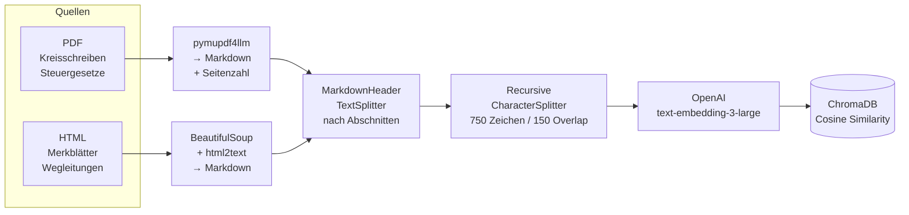
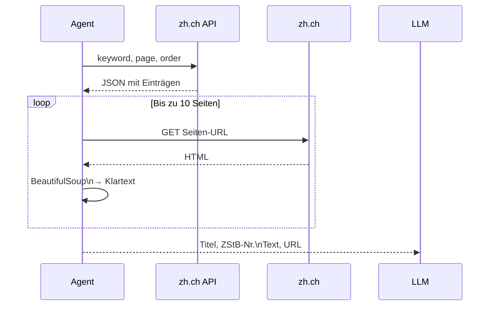

# RAG-Chatbot
## Züricher Steuerrecht

Hands-on Chatbot · OST FS26

<div class="abs-br m-6 text-sm opacity-60">Yannick Ott <br>Noah Debbabi</div>

---
layout: section
---

# 1. Motivation und Problemstellung

---

## Das Problem

Steuerrecht ist komplex und ändert sich laufend.

- Bürger und KMUs finden in PDFs, Kreisschreiben und dem Züricher Steuerbuch kaum schnell präzise Antworten
- Ein LLM alleine **halluziniert** zu leicht bei Rechtsfragen
- Quellen fehlen — man weiss nicht, worauf sich die Antwort stützt

---

## Unser Ziel

Ein Chatbot der Fragen zu Züricher Steuerrecht beantwortet:

<v-clicks>

- **Quellenbasiert** — jede Antwort mit Dokumentenangabe
- **Transparent** — Seite, Abschnitt und URL sichtbar
- **Aktuell** — greift auf Daten von 2025 zu und live auf das Züricher Steuerbuch
- **Ohne Halluzinationen** — antwortet nur aus Kontext

</v-clicks>


---
layout: section
--

# 2. Architektur

---

## Gesamtarchitektur

<script setup>
const archDiagram = `
flowchart LR
    USER([Benutzer])
    PDF[PDFs] -->|Indexierung| DB
    HTML[HTML] -->|Indexierung| DB
    USER --> EMB[Embedding]
    EMB --> DB[(ChromaDB)]
    DB --> CHUNKS[Top-5 Chunks]
    CHUNKS --> DEC
    USER -->|Frage| DEC
    DEC{Kontext ok?} -->|Ja| ANS[Antwort]
    DEC -->|Nein| TOOL[search_steuerbuch] --> LIVE[zh.ch API] --> ANS
    ANS --> OUT([Antwort + Quellen])
`
const archOptions = { nodeSpacing: 14, layerSpacing: 24, padding: 12 }
</script>

<div class="w-full h-80 overflow-hidden flex items-center justify-center">
  <BeautifulMermaid :diagram="archDiagram" theme="zinc-dark" :options="archOptions" />
</div>

---
layout: section
---

# 3. Dokumenten-Pipeline

---

## Von Rohdokumenten zu Embeddings



---
e
## Zwei-Pass Splitting

**Warum zwei Splitting-Schritte?**

<v-clicks>

**Pass 1 — MarkdownHeaderTextSplitter**
- Teilt nach `##` Überschriften auf (z.B. *A. Steuerpflicht*)
- Jeder Chunk bekommt den Abschnittsnamen als Metadatum
- Semantisch zusammengehöriger Inhalt bleibt zusammen

**Pass 2 — RecursiveCharacterTextSplitter**
- Maximal 750 Zeichen pro Chunk, 150 Überlappung
- Verhindert zu grosse Chunks die das Kontextfenster sprengen
- Quell-Metadaten (Datei, Seite, Abschnitt) bleiben erhalten

**Ergebnis:** Quellenangabe zeigt `steuergesetz.pdf (Seite 3, A. Steuerpflicht)`

</v-clicks>

---
layout: section
---

# 4. Agent & Tools

---
layout: two-cols
---

## Warum ein Agent?

Eine klassische RAG-Kette kann nur **lokale Dokumente** befragen.

Der Agent kann **selbst entscheiden**:
- Reichen die lokalen Docs?
- Soll das Steuerbuch online abgefragt werden?

<br>

**RAG-first Strategie:**
RAG wird **immer zuerst** ausgeführt. Der Kontext wird als Pflicht-Basis an den Agent übergeben — er antwortet nie aus dem Gedächtnis.

::right::

## Tool: `search_steuerbuch`



<div class="text-sm opacity-70 mt-4">
API entdeckt via Chrome DevTools → Network-Tab<br>
Endpoint: <code>flexdatasearch.zhweb-flexdata.zhweb-cache.json</code>
</div>

---
layout: section
---

# 5. Halluzinations-Unterdrückung

---

## Drei Massnahmen

<v-clicks>

### 1. RAG-first
Lokale Dokumente werden bei **jeder** Anfrage vorab geladen und als Kontext mitgegeben — unabhängig davon ob der Agent sie nutzt.

### 2. System-Prompt
```
"Nutze NUR den mitgegebenen Kontext als Wissensbasis —
ergänze NIEMALS aus dem Gedächtnis."
```

### 3. Expliziter Fallback
Wenn keine eindeutige Antwort möglich ist:

> *"Dazu konnte ich keine eindeutige Antwort finden. Bitte wenden Sie sich an das kantonale Steueramt Zürich."*

</v-clicks>

---
layout: section
---

# 6. Evaluation mit RAGAS

---
layout: two-cols
---

## Was ist RAGAS?

**R**etrieval **A**ugmented **G**eneration **As**sessment

- Automatische Qualitätsmessung für RAG-Systeme
- Generiert ein Testset aus den eigenen Dokumenten
- Berechnet 5 Metriken vollautomatisch

::right::

## Die 5 Metriken

| Metrik | Misst |
|---|---|
| **Answer Accuracy** | Korrektheit der Antwort |
| **Faithfulness** | Antwortet nur aus Kontext? |
| **Answer Relevancy** | Beantwortet die Frage? |
| **Context Precision** | Richtige Chunks gefunden? |
| **Context Recall** | Alle relevanten Chunks? |

---
layout: section
---

# 7. Technologie-Stack

---

## Verwendete Technologien

<div class="grid grid-cols-2 gap-8 mt-4">

<div>

### Backend & AI
| Komponente | Technologie |
|---|---|
| LLM | GPT-4o (OpenAI) |
| Agent-Framework | LangChain 1.2 |
| Embeddings | text-embedding-3-large |
| Vektordatenbank | ChromaDB (lokal) |
| Similarity | Cosine Distance |

</div>

<div>

### Dokumente & Tools
| Komponente | Technologie |
|---|---|
| PDF → Markdown | pymupdf4llm |
| HTML → Markdown | BeautifulSoup + html2text |
| Online-Suche | zh.ch JCR-API (custom Tool) |
| Evaluation | RAGAS |
| Paketmanager | uv |

</div>

</div>

---
layout: center
class: text-center
---

# Demo

*Live-Demonstration*

<div class="grid grid-cols-2 gap-8 mt-8 text-left">

<div class="border rounded p-4">
<div class="font-bold mb-2">Frage 1 — nur lokale Docs</div>
<div class="text-sm opacity-70">"Ab wann bin ich in Zürich steuerpflichtig?"</div>
<div class="text-xs mt-2 opacity-50">→ zeigt Quellenangabe mit Seite + Abschnitt</div>
</div>

<div class="border rounded p-4">
<div class="font-bold mb-2">Frage 2 — Steuerbuch-Tool</div>
<div class="text-sm opacity-70">"Was gilt für die Besteuerung von Homeoffice-Abzügen?"</div>
<div class="text-xs mt-2 opacity-50">→ triggert search_steuerbuch, zeigt zh.ch URLs</div>
</div>

</div>

---
layout: end
---

# Danke

Fragen?

<div class="mt-8 text-sm opacity-60">
RAG-Chatbot für Züricher Steuerrecht · OST FS26 · Yannick Ott, Noah Debbabi
</div>
