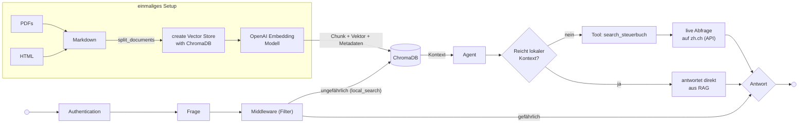
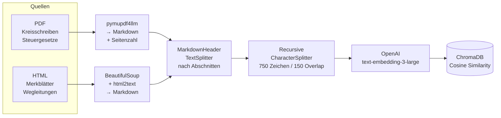
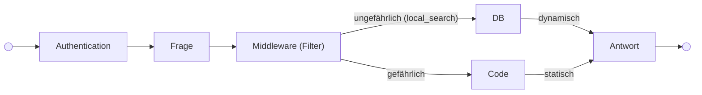

# <b> Agentic-RAG-Chatbot </b>
## Zürcher Steuerrecht

Hands-on Chatbot · OST FS26

<div class="abs-br m-6 text-sm opacity-60">Yannick Ott <br>Noah Debbabi</div>


---

## <b> <h1 class="text-emerald-600">Das Problem </h1></b>

<br><br><br>


- Bei Steuerfragen findet man kaum schnell präzise Antworten (grosse Datenmenge)
- Bei einem LLM ohne RAG fehlen die Quellangaben
- Steuerrecht ist komplex und ändert sich laufend


---

## <b> <h1 class="text-emerald-600">Unser Ziel</h1> </b>

<br><br>

**Ein Chatbot der Fragen zu zürcher Steuerrecht beantwortet**
<br><br>


- **Quellenbasiert:** jede Antwort mit Dokumentenangabe
- **Transparent:** Seite, Abschnitt und URL sichtbar
- **Aktuell:** greift auf Daten von 2025 zu und live auf das Züricher Steuerbuch
- **Ohne Halluzinationen:** antwortet nur aus Kontext


---

## <b> <h1 class="text-emerald-600"> Gesamtarchitektur: Agentic RAG </h1></b>

<br><br><br><br>




---

## <b> <h1 class="text-emerald-600">Von Rohdokumenten zu Embeddings</h1> </b>

<br><br><br><br>



---

## <b> <h1 class="text-emerald-600">Warum zwei Splitting-Schritte?</h1> </b>

<br>


**Pass 1 — MarkdownHeaderTextSplitter**
- Teilt nach `##` Überschriften auf (z.B. *A. Steuerpflicht*)
- Jeder Chunk bekommt den Abschnittsnamen als Metadatum
- Semantisch zusammengehöriger Inhalt bleibt zusammen


<br>


**Pass 2 — RecursiveCharacterTextSplitter**
- Maximal 750 Zeichen pro Chunk, 150 Überlappung
- Verhindert zu grosse Chunks die das Kontextfenster sprengen
- Quell-Metadaten (Datei, Seite, Abschnitt) bleiben erhalten


---


## <b> <h1 class="text-emerald-600"> Ergebnis </h1> </b>

<br>
```python
METADATEN: {'h2': '**A. Grundlagen**', 'page': 1, 'source': 'Merkbl_Selbst_ZH_2025.pdf'}
INHALT: . 2 StG). Darüber hinaus ist mit der Steuererklärung das Hilfsblatt A einzureichen, das einen...
```
<br><br>
Quellenangabe zeigt für PDFs: 
<br>
```
steuergesetz.pdf (Seite 3, A. Steuerpflicht)
```
<br><br>
Quellenangabe zeigt für Steuerbuch Webseite: 

<br>
```
https://www.zh.ch/de/steuern-finanzen/steuern/treuhaender/steuerbuch/steuerbuch-definition/zstb-3-1.html?search=miete
```


---

## <b> <h1 class="text-emerald-600"> Warum ein Agent? </h1> </b>

<br><br><br>
Eine klassische RAG-Kette kann nur lokale Dokumente befragen.
<br>
Der Agent kann **selbst entscheiden**:
- Genügen die lokalen Docs?
- Soll das Steuerbuch online abgefragt werden?

<br><br>

**RAG-first Strategie:**
RAG wird **immer zuerst** ausgeführt. Der Kontext wird als Pflicht-Basis an den Agent übergeben und er antwortet nie aus dem Gedächtnis.


---

## <b> <h1 class="text-emerald-600"> Halluzinations-Unterdrückung </h1> </b>
<br>


### 1. RAG-first
Lokale Dokumente werden bei jeder Anfrage vorab geladen und als Kontext mitgegeben, unabhängig davon ob der Agent sie nutzt.

<br>

### 2. System-Prompt
```
"Nutze NUR den mitgegebenen Kontext als Wissensbasis und ergänze NIEMALS aus dem Gedächtnis."
```

<br>

### 3. Expliziter Fallback 
Wenn keine eindeutige Antwort möglich ist:
```
"Dazu konnte ich keine eindeutige Antwort finden. Bitte wenden Sie sich an das kantonale Steueramt Zürich."
```


---

## <b> <h1 class="text-emerald-600"> Evaluation mit RAGAS </h1> </b> 

<br>

| Metrik | Beschreibung               | RAG  | Agentic RAG |
|---|----------------------------|------|------|
| **Answer Accuracy** | Korrektheit der Antwort    | 0.48 | 0.43 |
| **Faithfulness** | Antwortet nur aus Kontext? | 0.92 | 0.85 |
| **Answer Relevancy** | Beantwortet die Frage?     | 0.86 | 0.64 |
| **Context Precision** | Richtige Chunks gefunden?  | 0.74 | 0.71 |
| **Context Recall** | Alle relevanten Chunks?    | 0.84 | 0.59 |

---


## <b> <h1 class="text-emerald-600"> Kontrollpunkte (Security, Middleware, LLM, Input) </h1> </b>
<br>



| Kontrollsegmente   | Beschreibung                             |
|--------------------|------------------------------------------|
| **Authentication** | Login für den User                       |
| **LLM-as-a-Guard** | Middleware (Überprüfung Prompt)          |
| **Output Control** | LLM-Spezifikation wie llm und max_tokens |
| **Langfuse**       | Überwachung der LLM calls                |

---

# <b> <h1 class="text-emerald-600"> Live-Demo </h1> </b>

<br>

<div class="grid grid-cols-2 gap-8 mt-8 text-left">

<div class="border rounded p-4">
<div class="font-bold mb-2">Frage 1 — nur lokale Docs</div>
<div class="text-sm opacity-70">"Muss ich meinen Lottogewinn versteurn?"</div>
<div class="text-xs mt-2 opacity-50">→ zeigt Quellenangabe mit Seite + Abschnitt</div>
</div>

<div class="border rounded p-4">
<div class="font-bold mb-2">Frage 2 — Steuerbuch-Tool</div>
<div class="text-sm opacity-70">"Kann ich meine Miete von den Steuern abziehen?"</div>
<div class="text-xs mt-2 opacity-50">→ triggert search_steuerbuch, zeigt zh.ch URLs</div>
</div>

</div>

---
