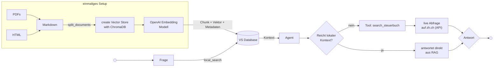
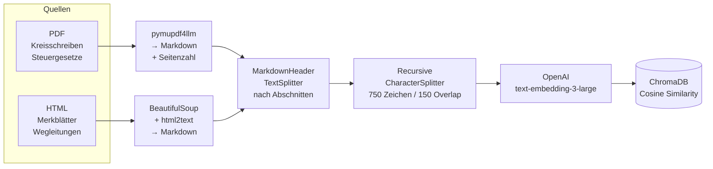

# RAG-Chatbot
## Züricher Steuerrecht

Hands-on Chatbot · OST FS26

<div class="abs-br m-6 text-sm opacity-60">Yannick Ott <br>Noah Debbabi</div>


---

## Das Problem

<br><br><br><br>
<v-clicks>

- Bei Steuerfragen findet man kaum schnell präzise Antworten (grosse Datenmenge)
- Bei einem LLM ohne RAG fehlen die Quellangaben
- Steuerrecht ist komplex und ändert sich laufend.

</v-clicks>

---

## Unser Ziel

<br><br>

**Ein Chatbot der Fragen zu Züricher Steuerrecht beantwortet.**
<br><br>
<v-clicks>


- **Quellenbasiert:** jede Antwort mit Dokumentenangabe
- **Transparent:** Seite, Abschnitt und URL sichtbar
- **Aktuell:** greift auf Daten von 2025 zu und live auf das Züricher Steuerbuch
- **Ohne Halluzinationen:** antwortet nur aus Kontext

</v-clicks>

---

## Gesamtarchitektur

<br><br><br><br>




---

## Von Rohdokumenten zu Embeddings

<br><br><br><br>



---

## Warum zwei Splitting-Schritte?

<br>

<v-clicks>

**Pass 1 — MarkdownHeaderTextSplitter**
- Teilt nach `##` Überschriften auf (z.B. *A. Steuerpflicht*)
- Jeder Chunk bekommt den Abschnittsnamen als Metadatum
- Semantisch zusammengehöriger Inhalt bleibt zusammen

</v-clicks>
<br>
<v-clicks>

**Pass 2 — RecursiveCharacterTextSplitter**
- Maximal 750 Zeichen pro Chunk, 150 Überlappung
- Verhindert zu grosse Chunks die das Kontextfenster sprengen
- Quell-Metadaten (Datei, Seite, Abschnitt) bleiben erhalten

</v-clicks>


---


## Ergebnis
<br><br><br><br><br>
Quellenangabe zeigt für PDFs: 
<br>
`steuergesetz.pdf (Seite 3, A. Steuerpflicht)`
<br><br><br>
Quellenangabe zeigt für Steuberbuch Webseite: 
<br>
`https://www.zh.ch/de/steuern-finanzen/steuern/treuhaender/steuerbuch/steuerbuch-definition/zstb-3-1.html?search=miete`


---

## Warum ein Agent?

<br><br><br>
Eine klassische RAG-Kette kann nur **lokale Dokumente** befragen.
<br>
Der Agent kann **selbst entscheiden**:
- Reichen die lokalen Docs?
- Soll das Steuerbuch online abgefragt werden?

<br><br>

**RAG-first Strategie:**
RAG wird **immer zuerst** ausgeführt. Der Kontext wird als Pflicht-Basis an den Agent übergeben und er antwortet nie aus dem Gedächtnis.


---

## Halluzinations-Unterdrückung
<br>
<v-clicks>

### 1. RAG-first
Lokale Dokumente werden bei **jeder** Anfrage vorab geladen und als Kontext mitgegeben — unabhängig davon ob der Agent sie nutzt.

### 2. System-Prompt
```
"Nutze NUR den mitgegebenen Kontext als Wissensbasis und
ergänze NIEMALS aus dem Gedächtnis."
```

### 3. Expliziter Fallback
Wenn keine eindeutige Antwort möglich ist:

> *"Dazu konnte ich keine eindeutige Antwort finden. Bitte wenden Sie sich an das kantonale Steueramt Zürich."*

</v-clicks>


---


## Evaluation mit RAGAS

<br><br>

**Die 5 Metriken:**

| Metrik | Misst |
|---|---|
| **Answer Accuracy** | Korrektheit der Antwort |
| **Faithfulness** | Antwortet nur aus Kontext? |
| **Answer Relevancy** | Beantwortet die Frage? |
| **Context Precision** | Richtige Chunks gefunden? |
| **Context Recall** | Alle relevanten Chunks? |

---


## RAGAS Ergebnisse


---


## UI mit Streamlit


---


## Herausforderungen
<br><br><br>

- Komplexität der einzelnen Komponenten verstehen
- Live Abruf von Daten mit Sortierung nach Relevanz


---

## Verbesserungspotential
<br><br><br>
- Konsitente Antworten zu bekommen (Aufruf vom Tool wird nur selten gemacht)


---
layout: center
class: text-center
---

# Demo

*Live-Demonstration*

<div class="grid grid-cols-2 gap-8 mt-8 text-left">

<div class="border rounded p-4">
<div class="font-bold mb-2">Frage 1 — nur lokale Docs</div>
<div class="text-sm opacity-70">"Ab wann bin ich in Zürich steuerpflichtig?"</div>
<div class="text-xs mt-2 opacity-50">→ zeigt Quellenangabe mit Seite + Abschnitt</div>
</div>

<div class="border rounded p-4">
<div class="font-bold mb-2">Frage 2 — Steuerbuch-Tool</div>
<div class="text-sm opacity-70">"Was gilt für die Besteuerung von Homeoffice-Abzügen?"</div>
<div class="text-xs mt-2 opacity-50">→ triggert search_steuerbuch, zeigt zh.ch URLs</div>
</div>

</div>

---
layout: cover
background: https://images.unsplash.com/photo-1527095655060-4026c4af2b25?q=80&w=3540&auto=format&fit=crop&ixlib=rb-4.1.0&ixid=M3wxMjA3fDB8MHxwaG90by1wYWdlfHx8fGVufDB8fHx8fA%3D%3D
---

# Fragen?

<div class="mt-8 text-sm opacity-60">
RAG-Chatbot für Züricher Steuerrecht · OST FS26
</div>

<div class="abs-br m-6 text-sm opacity-60">Yannick Ott <br>Noah Debbabi</div>
